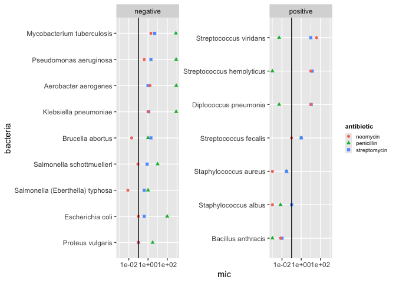
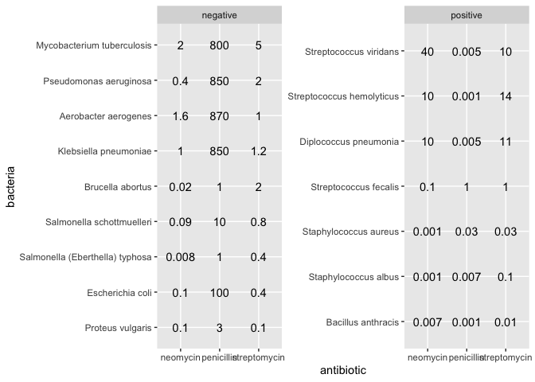
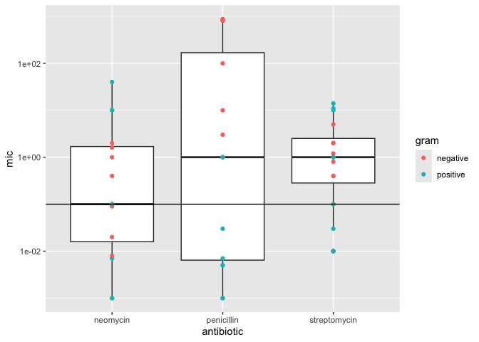
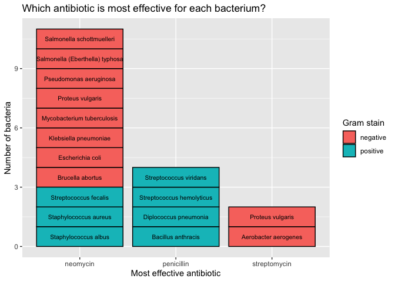
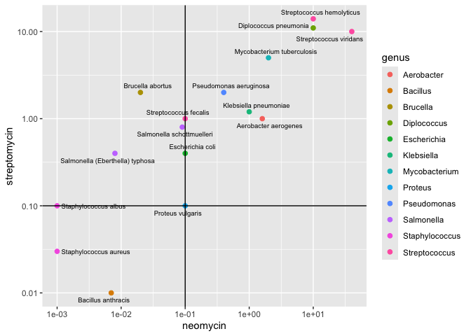

Antibiotics
================
Isabella Batalla
10/08/26

*Purpose*: Creating effective data visualizations is an *iterative*
process; very rarely will the first graph you make be the most
effective. The most effective thing you can do to be successful in this
iterative process is to *try multiple graphs* of the same data.

Furthermore, judging the effectiveness of a visual is completely
dependent on *the question you are trying to answer*. A visual that is
totally ineffective for one question may be perfect for answering a
different question.

In this challenge, you will practice *iterating* on data visualization,
and will anchor the *assessment* of your visuals using two different
questions.

*Note*: Please complete your initial visual design **alone**. Work on
both of your graphs alone, and save a version to your repo *before*
coming together with your team. This way you can all bring a diversity
of ideas to the table!

<!-- include-rubric -->

# Grading Rubric

<!-- -------------------------------------------------- -->

Unlike exercises, **challenges will be graded**. The following rubrics
define how you will be graded, both on an individual and team basis.

## Individual

<!-- ------------------------- -->

| Category | Needs Improvement | Satisfactory |
|----|----|----|
| Effort | Some task **q**’s left unattempted | All task **q**’s attempted |
| Observed | Did not document observations, or observations incorrect | Documented correct observations based on analysis |
| Supported | Some observations not clearly supported by analysis | All observations clearly supported by analysis (table, graph, etc.) |
| Assessed | Observations include claims not supported by the data, or reflect a level of certainty not warranted by the data | Observations are appropriately qualified by the quality & relevance of the data and (in)conclusiveness of the support |
| Specified | Uses the phrase “more data are necessary” without clarification | Any statement that “more data are necessary” specifies which *specific* data are needed to answer what *specific* question |
| Code Styled | Violations of the [style guide](https://style.tidyverse.org/) hinder readability | Code sufficiently close to the [style guide](https://style.tidyverse.org/) |

## Submission

<!-- ------------------------- -->

Make sure to commit both the challenge report (`report.md` file) and
supporting files (`report_files/` folder) when you are done! Then submit
a link to Canvas. **Your Challenge submission is not complete without
all files uploaded to GitHub.**

``` r
library(tidyverse)
```

    ## ── Attaching core tidyverse packages ──────────────────────── tidyverse 2.0.0 ──
    ## ✔ dplyr     1.2.0     ✔ readr     2.2.0
    ## ✔ forcats   1.0.1     ✔ stringr   1.6.0
    ## ✔ ggplot2   4.0.2     ✔ tibble    3.3.1
    ## ✔ lubridate 1.9.5     ✔ tidyr     1.3.2
    ## ✔ purrr     1.2.1     
    ## ── Conflicts ────────────────────────────────────────── tidyverse_conflicts() ──
    ## ✖ dplyr::filter() masks stats::filter()
    ## ✖ dplyr::lag()    masks stats::lag()
    ## ℹ Use the conflicted package (<http://conflicted.r-lib.org/>) to force all conflicts to become errors

``` r
library(ggrepel)
```

*Background*: The data\[1\] we study in this challenge report the
[*minimum inhibitory
concentration*](https://en.wikipedia.org/wiki/Minimum_inhibitory_concentration)
(MIC) of three drugs for different bacteria. The smaller the MIC for a
given drug and bacteria pair, the more practical the drug is for
treating that particular bacteria. An MIC value of *at most* 0.1 is
considered necessary for treating human patients.

These data report MIC values for three antibiotics—penicillin,
streptomycin, and neomycin—on 16 bacteria. Bacteria are categorized into
a genus based on a number of features, including their resistance to
antibiotics.

``` r
## NOTE: If you extracted all challenges to the same location,
## you shouldn't have to change this filename
filename <- "./data/antibiotics.csv"

## Load the data
df_antibiotics <- read_csv(filename)
```

    ## Rows: 16 Columns: 5
    ## ── Column specification ────────────────────────────────────────────────────────
    ## Delimiter: ","
    ## chr (2): bacteria, gram
    ## dbl (3): penicillin, streptomycin, neomycin
    ## 
    ## ℹ Use `spec()` to retrieve the full column specification for this data.
    ## ℹ Specify the column types or set `show_col_types = FALSE` to quiet this message.

``` r
# df_antibiotics %>% knitr::kable()

df_antibiotics
```

    ## # A tibble: 16 × 5
    ##    bacteria                        penicillin streptomycin neomycin gram    
    ##    <chr>                                <dbl>        <dbl>    <dbl> <chr>   
    ##  1 Aerobacter aerogenes               870             1       1.6   negative
    ##  2 Brucella abortus                     1             2       0.02  negative
    ##  3 Bacillus anthracis                   0.001         0.01    0.007 positive
    ##  4 Diplococcus pneumonia                0.005        11      10     positive
    ##  5 Escherichia coli                   100             0.4     0.1   negative
    ##  6 Klebsiella pneumoniae              850             1.2     1     negative
    ##  7 Mycobacterium tuberculosis         800             5       2     negative
    ##  8 Proteus vulgaris                     3             0.1     0.1   negative
    ##  9 Pseudomonas aeruginosa             850             2       0.4   negative
    ## 10 Salmonella (Eberthella) typhosa      1             0.4     0.008 negative
    ## 11 Salmonella schottmuelleri           10             0.8     0.09  negative
    ## 12 Staphylococcus albus                 0.007         0.1     0.001 positive
    ## 13 Staphylococcus aureus                0.03          0.03    0.001 positive
    ## 14 Streptococcus fecalis                1             1       0.1   positive
    ## 15 Streptococcus hemolyticus            0.001        14      10     positive
    ## 16 Streptococcus viridans               0.005        10      40     positive

# Visualization

<!-- -------------------------------------------------- -->

### **q1** Prototype 5 visuals

To start, construct **5 qualitatively different visualizations of the
data** `df_antibiotics`. These **cannot** be simple variations on the
same graph; for instance, if two of your visuals could be made identical
by calling `coord_flip()`, then these are *not* qualitatively different.

For all five of the visuals, you must show information on *all 16
bacteria*. For the first two visuals, you must *show all variables*.

*Hint 1*: Try working quickly on this part; come up with a bunch of
ideas, and don’t fixate on any one idea for too long. You will have a
chance to refine later in this challenge.

*Hint 2*: The data `df_antibiotics` are in a *wide* format; it may be
helpful to `pivot_longer()` the data to make certain visuals easier to
construct.

#### Visual 1 (All variables)

In this visual you must show *all three* effectiveness values for *all
16 bacteria*. This means **it must be possible to identify each of the
16 bacteria by name.** You must also show whether or not each bacterium
is Gram positive or negative.

``` r
# WRITE YOUR CODE HERE

df_long <- df_antibiotics %>%
  pivot_longer(
    cols = c(penicillin, streptomycin, neomycin),
    names_to = "antibiotic",
    values_to = "mic"
  )

df_long %>%
  mutate(bacteria = fct_reorder(bacteria, mic)) %>%
  ggplot(aes(mic, bacteria)) +
  geom_point(aes(color = antibiotic, shape = antibiotic)) +
  geom_vline(xintercept = 0.1) +
  facet_wrap(~gram, scales = "free_y") +
  scale_x_log10() +
  theme(
    legend.title = element_text(size = 8, face = "bold"),
    legend.text = element_text(size = 7),
    legend.key.size = unit(0.3, "cm"),
    legend.spacing.y = unit(0.1, "cm"))
```

<!-- -->

#### Visual 2 (All variables)

In this visual you must show *all three* effectiveness values for *all
16 bacteria*. This means **it must be possible to identify each of the
16 bacteria by name.** You must also show whether or not each bacterium
is Gram positive or negative.

Note that your visual must be *qualitatively different* from *all* of
your other visuals.

``` r
# WRITE YOUR CODE HERE
df_long <- df_antibiotics %>%
  pivot_longer(
    cols = c(penicillin, streptomycin, neomycin),
    names_to = "antibiotic",
    values_to = "mic"
  )


df_long %>%
  mutate(bacteria = fct_reorder(bacteria, mic)) %>%
  ggplot(aes(antibiotic, bacteria)) +
  geom_text(aes(label = mic)) +
  facet_wrap(~gram, scales = "free_y")
```

<!-- -->

#### Visual 3 (Some variables)

In this visual you may show a *subset* of the variables (`penicillin`,
`streptomycin`, `neomycin`, `gram`), but you must still show *all 16
bacteria*.

Note that your visual must be *qualitatively different* from *all* of
your other visuals.

``` r
# WRITE YOUR CODE HERE

df_long <- df_antibiotics %>%
  pivot_longer(
    cols = c(penicillin, streptomycin, neomycin),
    names_to = "antibiotic",
    values_to = "mic"
  )


df_long %>%
  ggplot(aes(antibiotic, mic)) +
  geom_boxplot() +
  geom_point(
    aes(color = gram)) +
  geom_hline(yintercept = 0.1) +
  scale_y_log10()
```

<!-- -->

#### Visual 4 (Some variables)

In this visual you may show a *subset* of the variables (`penicillin`,
`streptomycin`, `neomycin`, `gram`), but you must still show *all 16
bacteria*.

Note that your visual must be *qualitatively different* from *all* of
your other visuals.

``` r
# WRITE YOUR CODE HERE
df_long <- df_antibiotics %>%
  pivot_longer(
    cols = c(penicillin, streptomycin, neomycin),
    names_to = "antibiotic",
    values_to = "mic"
  )

df_long %>%
  group_by(bacteria) %>%
  filter(mic == min(mic)) %>%
  ggplot(aes(x = antibiotic, y = 1, fill = gram)) +
  geom_col(color = "black") +
  geom_text(aes(label = bacteria),
             position = position_stack(vjust = 0.5), size = 2.75) +
  labs(
    title = "Which antibiotic is most effective for each bacterium?",
    x = "Most effective antibiotic",
    y = "Number of bacteria",
    fill = "Gram stain"
  )
```

<!-- -->

#### Visual 5 (Some variables)

In this visual you may show a *subset* of the variables (`penicillin`,
`streptomycin`, `neomycin`, `gram`), but you must still show *all 16
bacteria*.

Note that your visual must be *qualitatively different* from *all* of
your other visuals.

``` r
# WRITE YOUR CODE HERE

# 
# filtered_by_genus <- 
#   df_long %>%
#   mutate(sep_bacteria = str_remove(bacteria, "\\s+\\([^\\)]+\\)")) %>%
#   separate(sep_bacteria, into = c("genus", "species"), sep = " ")
# 
# 
# filtered_by_genus %>%
#   ggplot(aes(species, mic)) +
#   geom_point(aes(color = antibiotic), size = 2) +
#   facet_grid(~genus, scales = "free_x") +
#   scale_y_log10() +
#   theme(
#     axis.text.x = element_text(angle = 270, vjust = 0.5, hjust = 0),
#     strip.text.x = element_text(angle = 270, vjust = 0.5, hjust = 0),
#   )


# WRITE YOUR CODE HERE

filtered_by_genus <- 
  df_antibiotics %>%
  mutate(sep_bacteria = str_remove(bacteria, "\\s+\\([^\\)]+\\)")) %>%
  separate(sep_bacteria, into = c("genus", "species"), sep = " ")

filtered_by_genus %>%
  ggplot(aes(neomycin, streptomycin)) +
  geom_point(aes(color = genus), size = 2) +
  geom_text_repel(aes(label = bacteria), size = 2.5) +
  geom_hline(yintercept = 0.1) +
  geom_vline(xintercept = 0.1) +
  scale_x_log10() +
  scale_y_log10()
```

<!-- -->

### **q2** Assess your visuals

There are **two questions** below; use your five visuals to help answer
both Guiding Questions. Note that you must also identify which of your
five visuals were most helpful in answering the questions.

*Hint 1*: It’s possible that *none* of your visuals is effective in
answering the questions below. You may need to revise one or more of
your visuals to answer the questions below!

*Hint 2*: It’s **highly unlikely** that the same visual is the most
effective at helping answer both guiding questions. **Use this as an
opportunity to think about why this is.**

#### Guiding Question 1

> How do the three antibiotics vary in their effectiveness against
> bacteria of different genera and Gram stain?

*Observations* - What is your response to the question above? - For
penicillin, most positive gram bacteria have lower MIC, meaning that
they are more effective. For negative gram bacteria, however, they are
more resistant to Penicillin, including Aerobacter aerogenes and several
others.

For streptomycin, there doesn’t seem to be a certain kind of gram
bacteria that it is more effective for. The effectiveness seems to just
be dependent on the bacteria itself, not its gram.

For neomycin, its effectiveness is similar to streptomycin in that it
isn’t ‘better’ for positive or negative gram bacteria.

One thing to note: For the most part, both neomycin and streptomycin are
more effective for gram negative bacteria than penicillin.

- Which of your visuals above (1 through 5) is **most effective** at
  helping to answer this question?

My second visual.

- Why? -

After revising my second visual to show the actual MIC values for each
antibiotic, it became much easier to judge how effective each antibiotic
is against each bacterium. My other visuals show values as positions on
a log-scaled axis, so you can see the pattern but not the true number.
Printing the values lets me compare them directly against the 0.1
threshold. Splitting by Gram stain also lets me compare the positive and
negative groups side by side.

#### Guiding Question 2

In 1974 *Diplococcus pneumoniae* was renamed *Streptococcus pneumoniae*,
and in 1984 *Streptococcus fecalis* was renamed *Enterococcus fecalis*
\[2\].

> Why was *Diplococcus pneumoniae* was renamed *Streptococcus
> pneumoniae*?

*Observations* - What is your response to the question above?

It’s possible that Diplococcus pneumoniae was renamed Streptococcus
pneumoniae due to the similarities it shares with the ‘Streptococcus’
genus. In my fifth visual, Diplococcus pneumoniae sits close to the
Streptococcus bacteria for neomycin and streptomycin, which suggests it
responds to those antibiotics similarly. Since both are gram positive,
they also react similarly to penicillin, which I can see in the values
in my second visual.

- Which of your visuals above (1 through 5) is **most effective** at
  helping to answer this question?

My fifth visual

- Why?

In my fifth visual, I plotted neomycin against streptomycin and colored
the points by genus, which lets me see which bacteria cluster together
even when they belong to different genera. Faceting by genus, as my
earlier version did, put Diplococcus and Streptococcus in separate
panels, so I couldn’t compare them. The scatterplot puts them on the
same axes, so I can see how close together they are. \# References

<!-- -------------------------------------------------- -->

\[1\] Neomycin in skin infections: A new topical antibiotic with wide
antibacterial range and rarely sensitizing. Scope. 1951;3(5):4-7.

\[2\] Wainer and Lysen, “That’s Funny…” *American Scientist* (2009)
[link](https://www.americanscientist.org/article/thats-funny)
